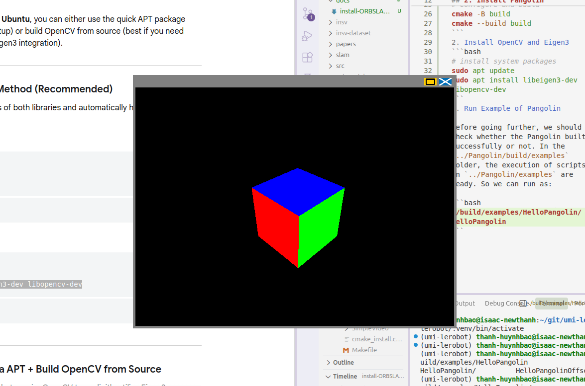

# Install ORBSLAM3
**Author**: Thanh B. Huynh

This is the guide for installing ORBSLAM3.

**Outline:**

    1. Folder
    2. Install Pangolin
    3. Orbslam3
        3.1. Cloning ORBSLAM3
        3.2. Structure of ORBSLAM3
        3.3. Build ORBSLAM3
    4. References
## 1. Folder
I refer to install the ORBSLAM3[^1] and relative tools in `submodules` folder. Therefore, we prompt from the `umi-lerobot` folder as follows:
```bash
# Create and access to /umi-lerobot/submodules/ folder
mkdir -p submodules
cd submodules
```
## 2. Install Pangolin 
According to `main` branch of **ORBSLAM3**, **Pangolin**[^2], **OpenCV** and **Eigen3** are needed to be installed before building SLAM.
1. Install Pangolin
```bash
# clone Pangolin with it's submodules using --recursive
git clone --recursive https://github.com/stevenlovegrove/Pangolin.git

# access to /umi-lerobot/submodules/Pangolin
cd Pangolin

# Install Pangolin's dependencies
./scripts/install_prerequisites.sh

# Configure and build
cmake -B build
cmake --build build
```
2. Install OpenCV and Eigen3
```bash
# install system packages
sudo apt update
sudo apt install libeigen3-dev libopencv-dev
```
3. Run Example of Pangolin

Before going further, we should check whether the Pangolin built successfully or not. In the 
`../Pangolin/build/examples` folder, the execution of scripts in `../Pangolin/examples` are ready. So we can run as:

```bash
# Run an example
./build/examples/HelloPangolin/HelloPangolin
```
*Fig 1: Pangolin's example*


The figure 1 present that the example has been run successfully. We can interact with the cube inside the opened window by dragging. Now you may recognize that Pangolin is a visualize app.

## 3. Orbslam3
Now let move back to `/umi-lerobot/submodules/` folder, we are going to install **ORBSLAM3**.
### 3.1. Cloning **ORBSLAM3** repo
```bash
# clone the ORBSLAM3 repo with the c++14 branch
git clone -b c++14_comp --singble-branch https://github.com/UZ-SLAMLab/ORB_SLAM3.git
```

### 3.2. Structure of **ORBSLAM3**
Of course, there are a lot of files and folders inside, however, I will present just some of them. We just put our attention on the important assets.

```tree
.../
ORBSLAM3/
    |--build/        --> appear after build
    |--lib/          
    |--Examples/
    |--Examples-old/
    |--Vocabulary/
    |--build.sh
    |--CMakeLists.txt
    |--Thirdparty/
    |...
```
* `build/`: will appear after build.
* `lib/`: stores the `libORB_SLAM3.so` file which is the output file after running `build.sh`.
* `Examples` and `Examples-old`: contain script that can be executed after built
* `Vocabulary/`: extract the file inside this folder. It is very important to run SLAM
* `build.sh`: main build script. We run this script for installing **ORBSLAM3**. For me, it is a bit complicated so we need to modify it.
* `CMakeLists.txt`: is also needed to be modified. 
* `Thirdparty/`: contains thirparty packages needed for build.

### 3.3. Build **ORBSLAM3**
As I mentioned above, `build.sh` is a main build file. You can run this immediately as you like. However, I am sure 99% you will meet brittle issues at your first try without modification. For that reason, I recommend to modify `build.sh` and `CMakeLists.txt`.

1. Modify `build.sh`
> `build.sh` file:
```bash
###########################
# Part 1: Build Thirdparty
###########################
echo "Configuring and building Thirdparty/DBoW2 ..."

cd Thirdparty/DBoW2
mkdir build
cd build
cmake .. -DCMAKE_BUILD_TYPE=Release
make -j

cd ../../g2o

echo "Configuring and building Thirdparty/g2o ..."

mkdir build
cd build
cmake .. -DCMAKE_BUILD_TYPE=Release
make -j

cd ../../Sophus

echo "Configuring and building Thirdparty/Sophus ..."

mkdir build
cd build
cmake .. -DCMAKE_BUILD_TYPE=Release
make -j

cd ../../../

echo "Uncompress vocabulary ..."
###########################
# Part 2: Extract Vocabulary and build SLAM
###########################
cd Vocabulary
tar -xf ORBvoc.txt.tar.gz
cd ..

echo "Configuring and building ORB_SLAM3 ..."

mkdir build
cd build
cmake .. -DCMAKE_BUILD_TYPE=Release
make -j4
```

We should divide this file into two parts: build thirparty part and build SLAM part. You may like to build the thirdparty first, so just simply `comment` the second part and run `./build.sh`. Then you `uncomment` the second part and `comment` the first part and `./build.sh` again. Or you can split it into two separated files. It is up to you.

But this leads to the second problem. Because the mismatching between new and old `c++ compiler`, `CMakeLists.txt` of ORBSLAM3 and thirdparty packages must be modified.

2. Modify `CMakeLists.txt`
> Before modify:
* `ORBSLAM3/CMakeLists.txt`:
```cmake
cmake_minimum_required(VERSION 2.8)
```
* `ORB_SLAM3/Thirdparty/DBoW2/CMakeLists.txt`:
```cmake
cmake_minimum_required(VERSION 2.8)
```
* `ORB_SLAM3/Thirdparty/g2o/CMakeLists.txt`:
```cmake
cmake_minimum_required(VERSION 2.8)
```
* `ORB_SLAM3/Thirdparty/Sophus/CMakeLists.txt`:
```cmake
cmake_minimum_required(VERSION 3.4)
```
> After: change them all to
```cmake
cmake_minimum_required(VERSION 3.5)
```
So now, you can feel comfortable to start running build. After the build is success, `lib/libORB_SLAM3.so` would appear.

## 4. References
[^1]: UZ-SLAMLab *(access: 2026)*, **ORBSLAM3**. github: https://github.com/UZ-SLAMLab/ORB_SLAM3/tree/master.

[^2]: stevenlovegrove *(access: 2026)*, **Pangolin**. github: https://github.com/stevenlovegrove/Pangolin.